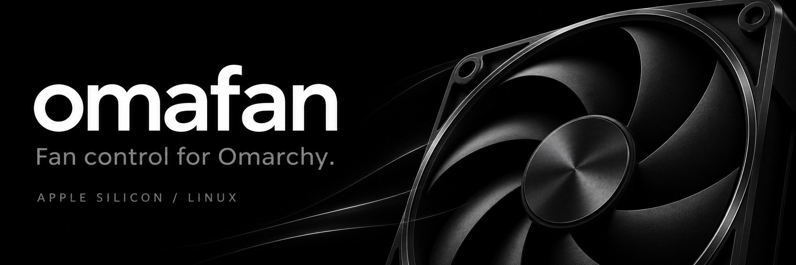
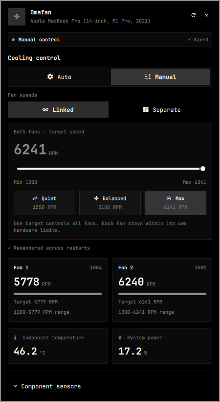
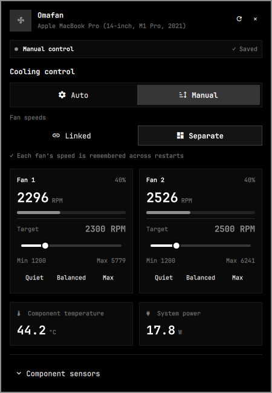
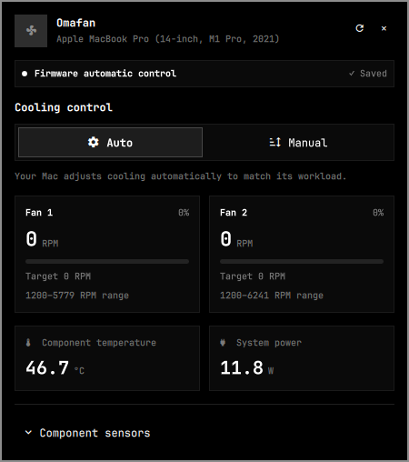

# Omafan

[](https://github.com/kartikkabadi/omafan/actions/workflows/tests.yml)
[](LICENSE)
[](https://omarchy.org)

Fan monitoring and optional persistent fan control for **Apple Silicon Macs
running Linux and Omarchy**. Omafan lives in your bar, reads the local
`macsmc_hwmon` driver, and keeps Linked and Separate settings ready to restore.
It is not a macOS application.

- **Linked or Separate.** One shared RPM slider, or independent controls for
  each fan. Each layout remembers its own settings, including through Auto.
- **Settings that stay saved.** The optional root service restores the active
  choice after shell/service restarts and reboot, when hardware and sensor
  checks permit it. The popup separates saved intent from actual state.
- **A quiet place in the bar.** Smooth, constant-speed fan animation, a compact
  popup, per-fan RPM and targets, component temperatures and system power.
- **Local operation.** No accounts, analytics, network requests or downloaded
  runtime dependencies. Monitoring works without administrator permissions.

Omafan builds on [LukasMoriarty's AppleSiliconThermals](https://github.com/LukasMoriarty/AppleSiliconThermals).
The original work and copyright are retained under the [MIT license](LICENSE).
Maintained by [Kartik (@kartikkabadi)](https://github.com/kartikkabadi).

## Install

```bash
omarchy plugin add https://github.com/kartikkabadi/omafan.git --enable
```

This installs monitoring. To enable optional manual control, review the source,
then run from the installed checkout **as your normal desktop user**:

```bash
cd ~/.config/omarchy/plugins/io.github.kartikkabadi.omafan
./setup.sh --enable-manual-control
```

The script handles authentication; do not prefix it with `sudo`.
Existing AppleSiliconThermals users should follow the
[migration guide](docs/MIGRATION.md) to replace the old widget without losing
saved profiles or running duplicate controls.

## Remove

If manual control is installed, release the fans and remove the optional backend
**before** removing the widget:

```bash
cd ~/.config/omarchy/plugins/io.github.kartikkabadi.omafan
./uninstall.sh
omarchy plugin disable io.github.kartikkabadi.omafan
omarchy plugin remove io.github.kartikkabadi.omafan
```

Monitoring-only installations need just the last two commands. The uninstaller
verifies firmware Auto before removing the controller and active saved setting;
upgrade backups remain. Removing just the widget leaves an installed controller
and its saved setting running. [Full removal guide](docs/INSTALL.md#remove).

## Three ways to run your fans

| Linked | Separate | Auto |
| :---: | :---: | :---: |
| [](assets/screenshots/linked.png) | [](assets/screenshots/separate.png) | [](assets/screenshots/auto.png) |
| One saved target for both fans. | Each fan keeps its own saved speed. | Firmware manages cooling. |

Screenshots show Omafan running on the tested M1 Pro. Click an image for its
full-size view. Linked and Separate are the two manual layouts; Auto is the
third control view. [Artwork and screenshot provenance](docs/MEDIA.md).

## Compatibility and limits

Requires Python 3.10+ at `/usr/bin/python3`, `macsmc_hwmon`, and Omarchy's
Quickshell shell. Manual control also requires systemd and sudo 1.9.10+.
Tested on a **14-inch 2021 M1 Pro MacBook Pro**, Arch Linux ARM kernel
7.2.11-14-1-ARCH, Omarchy 4.5.0, Quickshell 0.3.2 and Qt 6.12.
Fanless hardware can display available readings without fan controls; other
physical models remain unverified.

Temperatures are peripheral/component readings, **not CPU/GPU die temperatures**.
Manual control is a fixed RPM override, not a temperature curve. The kernel
marks this override unsafe; software safeguards cannot guarantee cooling during
every hardware or kernel failure. Keep firmware Auto for normal use and run
only one fan controller. Real suspend/hibernate/reboot remain fixture-tested,
not physically verified on the test machine.

## Guides

- [Installation, updates and removal](docs/INSTALL.md)
- [Controls, remembered profiles and recovery](docs/CONTROL.md)
- [Migration from AppleSiliconThermals](docs/MIGRATION.md)
- [Troubleshooting](docs/TROUBLESHOOTING.md)
- [Development and verification](docs/DEVELOPMENT.md)
- [Validation history and hardware-test limits](VALIDATION.md)

Report reproducible problems through [GitHub issues](https://github.com/kartikkabadi/omafan/issues),
including your model, kernel and Omarchy/Qt versions and the visible error.
Review diagnostics before posting them; omit private environment dumps.
